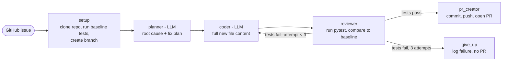

# Autonomous Dev Agent

A multi-agent pipeline that takes a GitHub issue, fixes the bug, and opens a pull request.

A **planner** agent reads the issue and the code and writes a fix plan. A **coder** agent rewrites the affected file. A **reviewer** runs the test suite and, if tests fail, sends the failure output back to the coder (up to 3 attempts). When the tests pass, the pipeline commits to a new branch and opens a PR linked to the issue. Every step is logged, so failed runs can be traced.

Built with **LangGraph**, **Azure OpenAI (gpt-5-mini)**, **Pydantic structured outputs**, **PyGithub** and **pytest**.

Example PRs opened by the agent: [alisha-mund/textutils/pulls](https://github.com/alisha-mund/textutils/pulls)

---

## How it works



Any step that hits an error ends the run and records the error in the run log.

| Node | Uses LLM? | What it does |
|---|---|---|
| `setup` | No | Fetches the issue, resets a clean clone of the repo, records which tests already fail on `main`, creates `agent/issue-<n>` |
| `planner` | Yes | Reads the issue and the source code (not the tests) and returns a `Plan`: root cause, files to change, test files, steps |
| `coder` | Yes | Returns the complete new content of each file in the plan. On retries it also gets the failing test output |
| `reviewer` | No | Runs the full test suite and decides pass/fail against the baseline |
| `pr_creator` | No | Commits only the planned files, pushes the branch, opens a PR whose body is built from the run's measured results |
| `give_up` | No | After 3 failed attempts, records the failure (with the last test output) and stops without a PR |

## Key design decisions

- **LLMs only where judgment is needed.** Planning and coding use the model. Setup, testing, pass/fail and PR creation are plain Python, so they are cheap, testable and reproducible.
- **Full files, not diffs.** The coder returns whole files through a Pydantic structured output. LLM-generated diffs often fail to apply; full files are simple to validate and write.
- **Tests are the reviewer's spec.** The coder never sees test files. It only learns what the tests expect from the failure output, so the retry loop is driven by real test feedback.
- **Pass = fixed + nothing broken.** `main` can contain other open bugs, so "all tests pass" is the wrong check. A fix passes when the issue's tests pass **and** no test that passed on `main` now fails.
- **Model output is checked before it is used.** File paths from the planner are validated against the real repo, test files are kept only if they import the changed module, and the coder can only write files from the plan.
- **Guardrails in code, not in prompts.** The agent cannot edit test files, write outside the repo, or push to anything other than `agent/*` branches. The GitHub token is scoped to one repo and is never written to disk or into logs.

## Results

Dry run on the three seeded bugs in [textutils](https://github.com/alisha-mund/textutils) (gpt-5-mini, reasoning effort `minimal`):

| Issue | Bug | Attempts | Tokens | Est. cost |
|---|---|---|---|---|
| #1 | `truncate()` ignores suffix length | 1 | 2,073 | $0.0015 |
| #2 | `percentage()` uses floor division; zero total not handled | 2 | 3,126 | $0.0020 |
| #3 | `word_count()` splits on single spaces only | 1 | 1,818 | $0.0011 |

Issue #2 shows the retry loop: the first fix raised `ZeroDivisionError`, the test expected `ValueError`, and the coder corrected it on attempt 2.

```
[setup] percentage() returns 0 for most inputs | baseline: 9 failing
[planner] change ['textutils/numbers.py'] | verify with ['tests/test_numbers.py']
[coder] attempt 1: Fixed percentage to use true division, handle division by zero by raising ZeroDivisionError, ...
[reviewer] FAILED: 1 target test(s) still failing
[coder] attempt 2: Changed percentage to raise ValueError (instead of ZeroDivisionError) when total is zero, ...
[reviewer] PASSED: Target tests pass and no regressions.
```

## Quickstart

**Requirements:** Python 3.11+, git, an Azure OpenAI deployment (or an OpenAI API key), and a GitHub fine-grained token for the target repo with *Contents: read/write*, *Pull requests: read/write*, *Issues: read*.

```bash
git clone https://github.com/alisha-mund/autonomous-dev-agent.git
cd autonomous-dev-agent
python -m venv .venv
source .venv/bin/activate        # Windows: .venv\Scripts\activate
pip install -r requirements.txt
cp .env.example .env             # then fill in your keys
```

```bash
# Fix one issue and open a PR
python main.py --repo <owner>/<repo> --issue 2

# Several issues
python main.py --repo <owner>/<repo> --issue 1 2 3

# Everything except commit/push/PR
python main.py --repo <owner>/<repo> --issue 2 --dry-run
```

Each run writes a JSON record to `runs/` with the result of every step (plan, coder explanation, test verdict per attempt, errors), token usage, estimated cost, and the final code diff.

### Configuration (`.env`)

| Variable | Purpose |
|---|---|
| `LLM_PROVIDER` | `azure` or `openai` |
| `AZURE_OPENAI_ENDPOINT`, `AZURE_OPENAI_API_KEY`, `AZURE_OPENAI_DEPLOYMENT` | Azure OpenAI settings |
| `OPENAI_API_KEY`, `OPENAI_MODEL` | Used when `LLM_PROVIDER=openai` |
| `LLM_TEMPERATURE` | e.g. `0`; leave empty for gpt-5 models |
| `LLM_REASONING_EFFORT` | e.g. `minimal`; only for gpt-5 models |
| `LLM_PRICE_INPUT_PER_M`, `LLM_PRICE_OUTPUT_PER_M` | List prices for cost estimates |
| `GITHUB_TOKEN` | Fine-grained token for the target repo |
| `WORKSPACE_DIR` | Where the target repo is cloned (default `./workspace`) |

## Project structure

```
agent/
  state.py     graph state (TypedDict) and LLM output schemas (Pydantic)
  llm.py       Azure/OpenAI client, structured calls, token usage and cost
  tools.py     files, pytest + baseline comparison, git, GitHub API (no LLM)
  nodes.py     setup, planner, coder, reviewer, give_up, pr_creator
  graph.py     LangGraph wiring and the retry loop
  run_log.py   one JSON record per run
main.py        CLI
```

## Limitations

- Built for small repositories: the planner receives all source files (capped at 40k characters). Larger repos would need a file-selection or retrieval step first.
- Tests run in the agent's own Python environment, not in an isolated sandbox, and the target repo's dependencies are not installed automatically.
- If one test file covers two unrelated bugs, failures from the other bug block the fix.
- Cost figures are estimates from list prices, not billing data.

## Roadmap

- Run tests in a Docker sandbox
- Unit tests for the tools and routing, with GitHub Actions CI
- Human-in-the-loop approval of the plan or PR (LangGraph `interrupt`)
- Resumable runs with a LangGraph checkpointer
- Evaluation script over `runs/`: success rate, attempts and cost per issue
- Trigger from GitHub Actions when an issue gets an `agent` label
